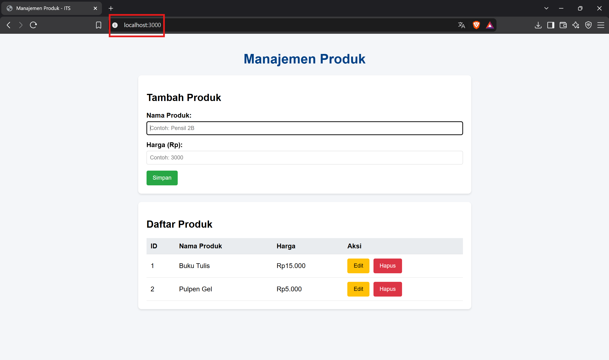
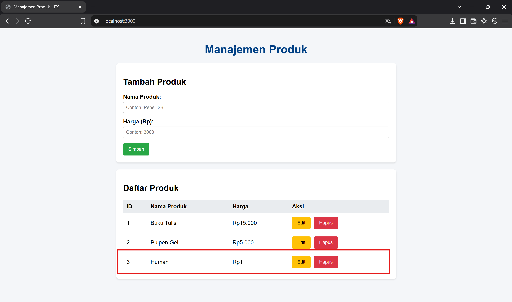
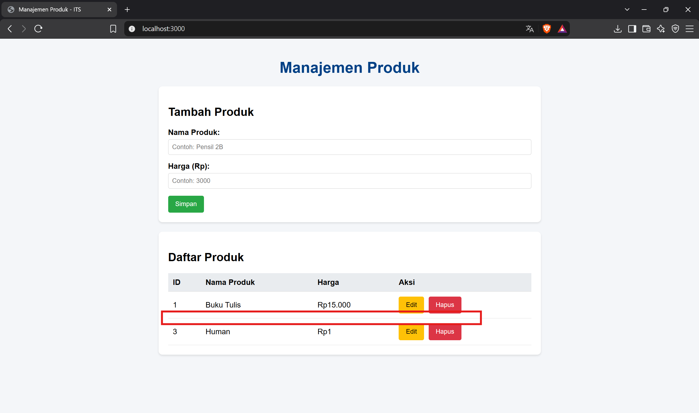

# 📦 Tugas Week 9 — Express CRUD dengan Prisma & PostgreSQL (Neon)

Sistem manajemen produk (Create, Read, Update, Delete) yang dibangun dengan **Express.js**, menggunakan **Prisma ORM** sebagai penghubung ke database **PostgreSQL** yang di-hosting di cloud **[Neon](https://neon.tech)**. Berbeda dengan versi sebelumnya yang menyimpan data di memori, kini data tersimpan permanen di database cloud.

## 🖼️ Preview Aplikasi



---

## 🚀 Teknologi yang Digunakan

| Teknologi | Keterangan |
|---|---|
| [Node.js](https://nodejs.org) | Runtime JavaScript di sisi server |
| [Express.js](https://expressjs.com) | Framework web untuk membuat REST API |
| [Prisma ORM](https://www.prisma.io) | ORM untuk akses database secara type-safe |
| [PostgreSQL — Neon](https://neon.tech) | Database serverless di cloud |
| HTML, CSS, JavaScript | Frontend sederhana di folder `public/` |

---

## 📁 Struktur Proyek

```
tugas week 9/
├── prisma/
│   ├── schema.prisma                    # Definisi model & koneksi database
│   └── migrations/                      # Riwayat migrasi tabel
├── src/
│   ├── index.js                         # Entry point server (port 3000)
│   ├── app.js                           # Konfigurasi Express & middleware
│   ├── prisma.js                        # Instance PrismaClient
│   ├── routes/
│   │   └── product.routes.js            # Routing endpoint /api/products
│   └── controllers/
│       └── product.controller.js        # Logika CRUD (query via Prisma)
├── public/
│   ├── index.html                       # Halaman utama
│   ├── main.js                          # Fetch API dari browser
│   └── style.css                        # Styling
├── screenshot/                          # Bukti hasil pengujian API
├── .env                                 # Kredensial database (tidak di-commit)
├── .env.example                         # Template environment
└── .gitignore
```

---

## ⛓️ Alur Data

```
Browser (public/main.js)
   │  fetch()
   ▼
Express API (src/index.js → app.js → routes)
   │
   ▼
Controller (src/controllers/product.controller.js)
   │  prisma.product.create() / findMany() / update() / delete()
   ▼
Prisma Client (src/prisma.js) + schema.prisma
   │  SQL: INSERT / SELECT / UPDATE / DELETE
   ▼
PostgreSQL "products" table — ☁️ Neon Cloud
```

---

## 📋 API Endpoint

| Metode | Endpoint | Fungsi |
|---|---|---|
| GET | `/api/products` | Menampilkan semua produk |
| POST | `/api/products` | Menambah produk baru |
| PUT | `/api/products/:id` | Mengubah produk berdasarkan ID |
| DELETE | `/api/products/:id` | Menghapus produk berdasarkan ID |

---

## 🛠️ Cara Menjalankan

1. **Install dependensi**
   ```bash
   npm install
   ```

2. **Konfigurasi database** — salin `.env.example` menjadi `.env`, lalu isi `DATABASE_URL` dengan connection string dari dashboard Neon.

3. **Buat tabel di database**
   ```bash
   npx prisma migrate dev
   ```

4. **Jalankan server**
   ```bash
   npm run dev
   ```

5. Buka `http://localhost:3000` di browser.

---

## 📸 Bukti Pengujian (Screenshot)

### 1️⃣ GET — Menampilkan Semua Produk

Data produk berhasil diambil dari database Neon dan ditampilkan di halaman utama.


### 2️⃣ POST — Menambah Produk Baru

Produk baru ditambahkan melalui form; data terkirim ke endpoint `/api/products` dan tersimpan di tabel `products` pada Neon.



### 3️⃣ PUT — Mengubah Produk

Produk diedit melalui endpoint PUT berdasarkan ID; perubahan harga/nama langsung tersimpan di database.

.png)

### 4️⃣ DELETE — Menghapus Produk

Produk dihapus melalui endpoint DELETE; baris yang bersangkutan hilang dari tabel `products` di Neon.



---

## ✅ Kenapa ORM / Prisma?

- **Tidak perlu menulis SQL manual** — query dibangun lewat API Prisma Client yang type-safe.
- **Schema terdokumentasi** — bentuk tabel didefinisikan di `prisma/schema.prisma`.
- **Migration terkelola** — setiap perubahan struktur tabel tercatat di folder `prisma/migrations/`, sehingga database bisa direplikasi ulang dari nol.
- **Serverless-friendly** — Prisma bekerja baik dengan pooled connection string milik Neon.

---

## 👤 Identitas

**Muhammad Ridwan** — 5027251113

Mata Kuliah: Pemrograman Web — Tugas Minggu 9
